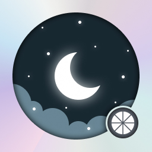

<div align="center">



# Moonlight Switch + ZeroTier

**Seu PC no Nintendo Switch, mesmo em outra rede.**

Baseado no [Moonlight-Switch de XITRIX e seus colaboradores](https://github.com/XITRIX/Moonlight-Switch), com ZeroTier integrado ao próprio aplicativo.

Parte do ecossistema [Moonlight Game Streaming](https://moonlight-stream.org/). Este fork é independente e não é uma versão oficial da equipe Moonlight.

[](#o-que-voce-precisa)
[](#configurar-o-zerotier)
[](https://github.com/tozzo28/Moonlight-Switch-ZeroTier/releases/latest)
[](https://github.com/tozzo28/Moonlight-Switch-ZeroTier/actions/workflows/checks.yml)

**[Baixar para o Switch](https://github.com/tozzo28/Moonlight-Switch-ZeroTier/releases/latest)** ·
[Instalar](#instalar-no-switch) ·
[Configurar](#configurar-o-zerotier) ·
[Compilar](docs/COMPILACAO.md)

</div>

---

## Como funciona

O **Sunshine** transmite o PC e o **Moonlight** recebe o streaming no Switch.
O **ZeroTier** conecta os dois aparelhos por uma rede virtual, mesmo quando estão
em conexões físicas diferentes.

**PC com Sunshine ⇄ sua rede ZeroTier ⇄ Moonlight no Switch**

Nesta versão, o ZeroTier funciona dentro do Moonlight. A integração atende às
conexões do aplicativo e não exige um sysmodule MITM global.

> **Pronto para você configurar:** o pacote começa com ZeroTier desativado,
> ID de rede e IP vazios, sem PC cadastrado e sem identidade ou chaves de outro usuário.

<a id="o-que-voce-precisa"></a>
## O que você precisa

| Onde | O que preparar |
| --- | --- |
| **Switch** | Ambiente homebrew funcionando e hbmenu com acesso completo à RAM. |
| **PC** | [Sunshine](https://github.com/SunshineStream/Sunshine) e [ZeroTier](https://www.zerotier.com/download/) instalados. |
| **Rede ZeroTier** | PC e Switch na mesma rede virtual, ambos autorizados no painel. |
| **Internet** | Conexão nos dois aparelhos e comunicação com o Sunshine permitida pelo firewall do PC. |

## Instalar no Switch

1. Abra **[Releases](https://github.com/tozzo28/Moonlight-Switch-ZeroTier/releases/latest)** e baixe o arquivo terminado em **`-switch.zip`**.
2. Extraia o ZIP e copie a pasta **`switch`** para a raiz do cartão SD.
3. Abra o **Moonlight** pelo hbmenu com acesso completo à RAM.
4. Siga a configuração do ZeroTier abaixo.

O arquivo do aplicativo ficará neste caminho:

```text
SD:/switch/Moonlight-Switch/Moonlight-Switch.nro
```

> Se o cartão já tinha Moonlight, os dados anteriores podem continuar sendo carregados.
> Instalar este pacote não apaga suas configurações existentes.

## Configurar o ZeroTier

### 1. Prepare o PC

- Deixe o **Sunshine** funcionando.
- No **ZeroTier do PC**, entre na sua rede virtual e autorize esse computador no painel.
- Anote o **IPv4 ZeroTier do PC**. É esse endereço que você vai informar no Moonlight.

Se ainda não tiver uma rede, veja o [guia oficial do ZeroTier](https://docs.zerotier.com/start/).

### 2. Configure o Switch

1. Nas configurações **ZeroTier** do Moonlight, informe:

   | Campo | O que colocar |
   | --- | --- |
   | **Network ID / ID da rede** | O identificador de 16 caracteres da sua rede ZeroTier. |
   | **Peer / IP do PC** | O IPv4 que o ZeroTier atribuiu ao computador com Sunshine. |

2. Habilite o ZeroTier, **feche completamente o Moonlight e abra-o novamente**.
3. Consulte o ID do dispositivo mostrado pelo aplicativo e **autorize o Switch** no painel da sua rede ZeroTier.
4. Aguarde o Switch receber um IP.

### 3. Conecte e jogue

1. Adicione o PC no Moonlight usando o **IP ZeroTier dele**.
2. Faça o pareamento e confirme o **PIN na interface do Sunshine**.
3. Escolha o **Desktop** ou um aplicativo disponível.
4. Comece em **720p / 60 FPS**, com bitrate moderado, e ajuste conforme sua rede.

[Guia de instalação completo](docs/INSTALACAO.md)

## Se precisar de ajuda

<details>
<summary><strong>O PC não aparece ou não conecta</strong></summary>

Confira o IP ZeroTier do PC, a autorização dos dois dispositivos na mesma rede,
o funcionamento do Sunshine e o firewall. O estado online do ZeroTier, sozinho,
não confirma que o Sunshine está acessível. Depois de alterar a rede ou o peer,
feche e reabra o Moonlight.

</details>

<details>
<summary><strong>Quero usar outro computador</strong></summary>

Prepare Sunshine e ZeroTier no outro PC, autorize-o na rede e informe o IP virtual
dele na configuração do Moonlight. Feche e reabra o aplicativo e faça o pareamento
com esse computador.

</details>

<details>
<summary><strong>Quero testar uma instalação totalmente nova</strong></summary>

Use uma instalação de teste sem os dados anteriores do Moonlight, preservando seus
backups. O aplicativo pode usar as pastas `switch/moonlight`, `switch/Moonlight-Switch`
e `switch/Moonlight-Switch-ZeroTier`. O pacote não remove arquivos que já estejam no cartão.

Nunca compartilhe `identity.secret`, arquivos PEM ou pastas de pareamento.

</details>

## Para desenvolvedores

```bash
# Testes de host
bash scripts/test-host.sh

# Compilação completa — já executa os testes
bash scripts/build-clean-release.sh

# ZIP do aplicativo, ZIP de fontes e hashes
python3 scripts/package-release.py --tag v1.5.0-zerotier.1
```

É necessário Linux ou WSL, devkitPro e as dependências indicadas no guia.
Os artefatos gerados ficam em `release/` e `dist/`, ignorados pelo Git.

**[Compilação e dependências](docs/COMPILACAO.md)** ·
[Contribuir](CONTRIBUTING.md) ·
[Alterações](CHANGELOG.md)

<details>
<summary><strong>Testes e estado desta versão</strong></summary>

| Verificação | Resultado registrado |
| --- | --- |
| Compilação | Concluída com devkitA64 16.1.0. |
| Rede virtual | 88 verificações VNet, sem falhas. |
| Transporte | Testes TCP/UDP, ENet, rede nativa, configuração e queda do link aprovados. |
| Interface e sessões | Gestos, cancelamento HTTP, retomada e migração de perfis aprovados. |
| Nintendo Switch | Funcionamento informado pelo usuário que testou o pacote. |

Os testes de host usam cenários sintéticos e loopback. Não há uma matriz completa de
aparelhos/redes nem medições públicas de desempenho.
A base da interface é **Moonlight-Switch 1.5.0**; a Release deste fork é **v1.5.0-zerotier.1**.

ZeroTier Core e curl são recompilados pelo script. Quatro bibliotecas FFmpeg públicas
verificadas permanecem pré-compiladas; a origem e os fontes da revisão identificada
acompanham o projeto. Detalhes em [avisos de terceiros](THIRD_PARTY_NOTICES.md).

</details>

## Créditos e licenças

Este projeto só é possível graças aos autores e colaboradores dos projetos originais:

- **[XITRIX/Moonlight-Switch](https://github.com/XITRIX/Moonlight-Switch)** — base deste fork, incluindo a interface e o cliente para Nintendo Switch. Créditos a XITRIX e a todos os [colaboradores do projeto original](https://github.com/XITRIX/Moonlight-Switch/graphs/contributors).
- **[Moonlight Game Streaming](https://moonlight-stream.org/)** — projeto original de streaming e comunidade que desenvolve seus clientes e bibliotecas. Conheça os [projetos oficiais no GitHub](https://github.com/moonlight-stream).
- **ZeroTier**, **Jul879n/sys-GRID0-tcp**, **lwIP**, **curl**, **FFmpeg/Averne** e os demais autores dos componentes vendorizados — dependências e trabalho que sustentam esta integração.

A contribuição deste fork é a integração do ZeroTier ao Moonlight-Switch. O nome e a imagem do Moonlight são usados para identificar a origem do projeto; não indicam endosso dos autores originais.

O aplicativo usa GPL-3.0; os componentes mantêm os termos e avisos descritos em
[LICENSE](LICENSE), [THIRD_PARTY_NOTICES.md](THIRD_PARTY_NOTICES.md) e
[revisão de licenças](docs/LICENCAS-REVISAO.md). Ao distribuir, preserve os fontes,
scripts, créditos e licenças correspondentes.

**Fork independente. Não é uma versão oficial da equipe Moonlight, de XITRIX, da Nintendo ou da ZeroTier.**
